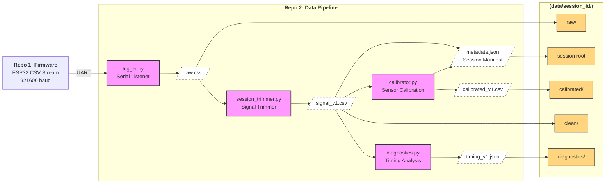
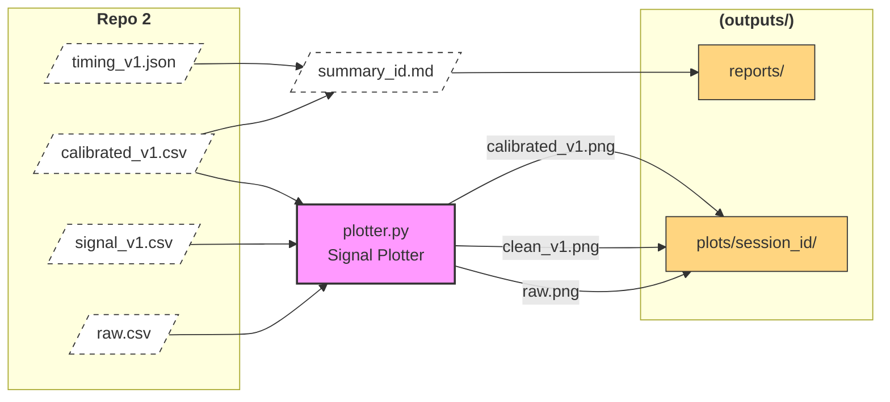
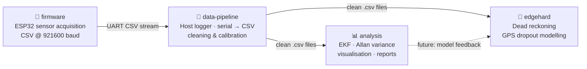

# Data Pipeline | Multi-Sensor Navigation System

[](https://www.python.org/)
[](https://pandas.pydata.org/)
[](https://numpy.org/)
[](https://scipy.org/)
[](LICENSE)
[](#multi-repo-structure)

> **Repo 2 of 4** · Deterministic serial logging, automated session trimming, and ultra-robust sensor calibration pipeline.
> 
> Transforms raw UART streams from [Repo 1](https://github.com/multi-sensor-navigation-system/firmware) into cleaned, calibrated and analysis-ready datasets.
>
> ⚠️ *This repository was named `navigation-system-pipeline` before moving under the `multi-sensor-navigation-system` organization from [@ShivtejG236](https://github.com/ShivtejG236).*

---

## What this is

The host-side processing engine for the navigation system. It handles high-speed UART data acquisition, performs signal/noise segmentation, generates timing diagnostics, and applies precise sensor calibration with built-in sanity checks.

The pipeline follows a deterministic multi-stage flow:

| Stage | Module | Responsibility | Output |
|---|---|---|---|
| **1. Log** | `logger.py` + `wire.py` | Binary frames (or CSV debug stream) → CSV | `raw/raw.csv`, `raw/firmware.json` |
| **2. Trim** | `session_trimmer.py` | Signal/Noise segmentation | `clean/signal_v1.csv` |
| **3. Diagnose** | `diagnostics.py` | Timing, jitter & alignment | `diagnostics/timing_v1.json` |
| **4. Calibrate** | `calibrator.py` | Bias, scale & hard-iron | `calibrated/calibrated_v1.csv` |
| **5. Plot** | `plotter.py` | Visual validation | `outputs/plots/*.png` |

---

## System Architecture




---

## Calibration

This pipeline is designed with strict validation checks to prevent invalid data from propagating downstream.

### Checks
If you attempt to run a dynamic session (`free_label`, `mag_rotation`) without a valid `calibration_params.json` in the root, the pipeline will halt and force a decision:
* **Strict Mode:** Abort and generate parameters from a `static_calib` session first.
* **Permissive Mode:** Continue uncalibrated (session flagged as `valid_for_analysis: false`).
* **Override:** Provide a custom path to a specific parameters file.

### Bias Sanity
During parameter computation, the system validates the results against physical limits:
* **Gyro Bias:** If `|bias| > 50 °/s`.
* **Accel Norm:** If `|a|` deviates from `1.0g` by more than 10%.
* **Mag Field:** If field radius is outside the Earth's natural range (`20–70 μT`).

*Calibration parameters are rejected and the session is marked invalid if they fail sanity checks. No calibrated output is generated.*

### Reports
Each calibration run produces a `calibration_v1.json` detailing out the particulars. Few of these labels are:
```json
{
  "version": 1,
  "input_file": "signal_v1.csv",
  "params_file": "calibration_params.json",
  "params_source_session": "session_20260502_224602_static_calib",
  "params_computed_at": "2026-05-02T22:46:20",
  "params_user_note": "flat on desk",
  "calibration_valid": false
}
```
Calibration stage executes for all runs, but may result in (for dynamic runs):
- valid calibrated output
- skipped (no parameters available)
- rejected (failed sanity checks)

Additionally, parameter generation requires valid static calibration data.

---

## Metadata Tracking

Every session produces a `metadata.json` that acts as a deterministic receipt for the run. A few of the labels are listed here:
```json
{
  "session_name": "session_20260502_224602_static_calib",
  "session_type": "static_calib",
  "is_calibrated": true,
  "calibration_source": "session_20260502_224602_static_calib",
  "calibration_valid": false,
  "user_overridden": false,
  "override_type": "none",
  "valid_for_analysis": false,
  "reason": "Internal calibration check failed (insufficient signal or failed sanity limits).",
  "created_at": "2026-05-02T22:46:21",
  "user_note": "flat on desk",
  "duration_s": 10.68,
  "total_rows": 4431,
  "imu_hz": 414.95
}
```

### Data Validity

Each session is categorized as:

- **Calibrated & Valid** → ready for analysis
- **Uncalibrated** → usable for debugging only
- **Invalid** → failed sanity checks or corrupted data

*Only "Calibrated & Valid" data should be used for downstream modeling or analysis.*

---

## Repo-02 Structure
```
data-pipeline/
├── data/                    # Raw and processed session data
├── outputs/
│   ├── plots/               # Visual validation plots
│   └── reports/             # Markdown session summaries
├── pipeline/
│   ├── logger.py            # High-speed UART listener
│   ├── wire.py              # Wire protocol v1 decoder (binary + CSV detection)
│   ├── session_trimmer.py   # Signal/Noise segmenter
│   ├── diagnostics.py       # Timing & jitter analysis
│   ├── calibrator.py        # Bias, scale & hard-iron calibration
│   └── plotter.py           # Multi-stage signal visualisation
├── run_pipeline.py          # Unified CLI entry point
└── README.md                # Technical documentation
```
---

## Setup

1. **Environment:** Create a virtualenv and install dependencies:
   ```bash
   python -m venv .nav
   source .nav/bin/activate
   pip install -r requirements.txt
   ```
2. **Hardware:** Connect the ESP32 via USB and identify the port (e.g., `/dev/cu.usbserial-0001`).
3. **Run:** Execute the pipeline and follow the prompts.

---

## Automation & CLI

The pipeline can be run interactively or fully automated via command-line arguments.

```bash
# Interactive mode (default)
python run_pipeline.py

# Automated mode (Action 2 = Run on existing, Action 3 = Re-run from step)
python run_pipeline.py --action 2 --session-dir data/session_XYZ --calib-mode 0
```
### Key CLI Arguments
| Argument | Options | Description |
|---|---|---|
| `--action` | `1-5` | Choose log, process, re-run, calibrate or list |
| `--session-type` | `static_calib`, `free_label`, etc | Set the session intent |
| `--session-dir` | session_id | Target session for processing |
| `--start-from` | `trim`, `diagnose`, `calibrate`, etc | Entry point for re-runs |
| `--calib-mode` | `0` (Strict), `1` (Permissive) | Handling of missing params |
| `--calib-path` | path/to/params.json | Custom path for calibration params |

*If --calib-path is provided, it overrides --calib-mode.*

For complete list, use `python run_pipeline.py --help`

---

## Highlights

### Calibration Lifecycle
- **Strict/Permissive Modes** – The pipeline prevents uncalibrated data from being used for analysis unless explicitly overridden.
- **Dry-Run Protection** – The system detects sessions with no meaningful sensor activity (e.g. all zeros or constant signals) and flags them as `calibration_valid: false`.
- **Traceability Receipts** – Every calibrated dataset includes a JSON receipt documenting the source session, computation timestamp and user notes for the parameters applied.

### State-aware Metadata
- **Dynamic Sensor Detection** – Automatically lists only the sensors that were actually reporting data in `metadata.json`.
- **Session Context** – Includes user-provided notes ("desk setup", "bike test") and state flags (`is_calibrated`, `calibration_valid`, `user_overridden`).

### Automated Processing
- **Trimming** – Signal/noise segmentation with reboot boundary detection.
- **Timing Integrity** – Jitter analysis and inter-sensor alignment diagnostics are generated for every run.

### Additional Guardrails
- **Session Safety** – Existing sessions are never overwritten. Logging always creates a new session directory to preserve data integrity.
- **Stage Independence** – The pipeline allows partially successful runs. Each step produces outputs independently where possible.

---

## Project Ecosystem



| Repo | Role | Status |
|---|---|---|
| [`firmware`](https://github.com/multi-sensor-navigation-system/firmware) | ESP32 firmware — sensor acquisition & CSV streaming | ✅ Active |
| **`data-pipeline`** ← *(this repo, formerly navigation-system-pipeline)* | Host-side logger & calibration — reads serial, writes timestamped CSV | ✅ Active |
| [`analysis`](#) | Offline processing — EKF, Allan variance, map visualisation, reports | 🚧 In progress |
| [`edgehard`](#) | Dead reckoning — GPS dropout modelling, edge inference | 🔜 Planned |
